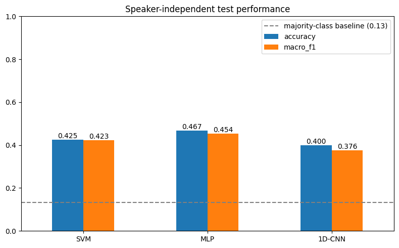
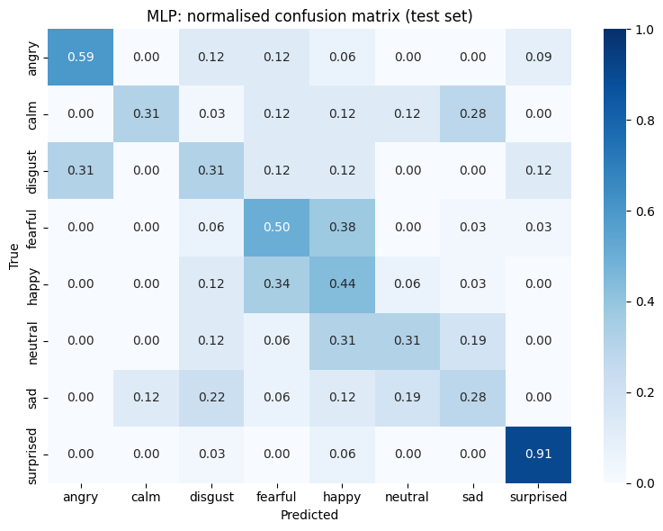
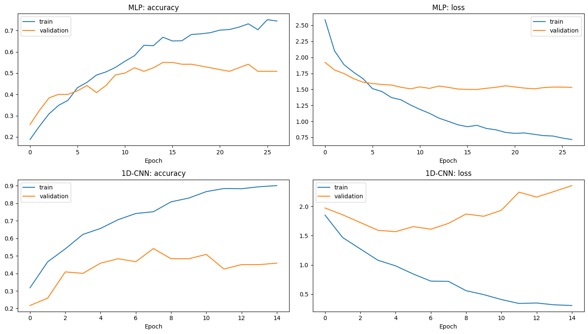

# Speech Emotion Recognition (RAVDESS)

Classifying eight emotions from short speech recordings and comparing a classical baseline with two neural models, all evaluated on **speakers the models have never heard**.

**Emotions:** neutral · calm · happy · sad · angry · fearful · disgust · surprised

## Results

Test set: actors 21–24 (240 clips), unseen during training and model selection.

| Model | Input | Accuracy | Macro F1 |
|---|---|---|---|
| SVM (RBF) | MFCC mean + std (80) | 0.425 | 0.423 |
| **MLP** | MFCC mean + std (80) | **0.467** | **0.454** |
| 1D-CNN | MFCC sequence (130 × 40) | 0.400 | 0.376 |

Majority-class baseline: 13.3%. With 240 test clips, each accuracy has a 95% confidence interval of roughly ±6 percentage points, so the MLP's lead over the SVM is not conclusive.





## Dataset

[RAVDESS](https://zenodo.org/records/1188976): 1,440 speech recordings from 24 professional actors (12 female, 12 male), each speaking two fixed sentences in eight emotions. Downloaded from the [Kaggle mirror](https://www.kaggle.com/datasets/uwrfkaggler/ravdess-emotional-speech-audio).

## Method

**Features.** Each clip is resampled to 22,050 Hz, the leading 0.5 s of silence is skipped, and the clip is cut or padded to 3 s. From this, 40 MFCCs are computed per frame. The SVM and MLP use the per-coefficient mean and standard deviation over time; the CNN uses the full frame-by-frame sequence.

**Evaluation design.** Two sources of data leakage are handled explicitly:

1. **Duplicate files.** The Kaggle archive contains every actor folder twice, so a recursive file search returns 2,880 files instead of 1,440. Without de-duplication, identical clips appear in both training and test data.
2. **Speaker overlap.** A random train/test split puts every actor's voice in both sets, letting a model recognise speakers rather than emotions. Instead, the data is split by actor:

| Split | Actors | Use |
|---|---|---|
| Train | 1–18 | Model fitting, feature scaling |
| Validation | 19–20 | Hyperparameter choice (SVM `C`), early stopping |
| Test | 21–24 | Final evaluation only |

Each split is gender-balanced. Because `neutral` has half as many clips as the other classes, models use balanced class weights and results include macro F1.

**Models.**
- **SVM** with RBF kernel; `C` selected on the validation actors.
- **MLP**: three dense layers (256-128-64) with batch normalisation and dropout.
- **1D-CNN**: three convolutional blocks along the time axis, global average pooling, dense classifier.

## Findings

**Errors follow arousal, not valence.** Emotions with similar energy levels are confused with each other:

- High arousal: fearful ↔ happy (38% / 34% of clips), disgust → angry (31%)
- Low arousal: calm → sad (28%), neutral → sad (19%)
- Surprised is the easiest class (91% recall)

MFCC statistics capture loudness and spectral spread, which separate calm from excited speech, but carry little information about whether an emotion is pleasant or unpleasant.

**The CNN overfits.** Training accuracy climbs to about 90% while validation loss rises after epoch 4. With only 18 training speakers, the sequence model learns speaker-specific detail rather than general emotion cues, and loses to the simpler models on summary features.



**Honest evaluation matters.** An earlier version of this project used a random split on the duplicated file list and reported 82% accuracy. Once duplicates were removed and test speakers were held out, accuracy fell to 40–47%. The lower number is the one that reflects how the model would perform on a new speaker.

## How to run

The notebook is designed for Google Colab but runs anywhere with Python 3.10+.

1. Create a Kaggle API token (*Kaggle → Settings → Create New Token*). This downloads `kaggle.json`.
2. Open `speech_emotion_recognition.ipynb` in Colab and run all cells. You'll be asked to upload `kaggle.json` once.

Locally: place `kaggle.json` in `~/.kaggle/`, then

```bash
pip install -r requirements.txt
jupyter notebook speech_emotion_recognition.ipynb
```

## Possible improvements

- Data augmentation (noise, pitch shift, time stretch), especially to reduce CNN overfitting
- Prosodic features (pitch contour, energy, speaking rate) to separate emotions with similar arousal
- Log-mel spectrograms with a 2D-CNN
- Cross-validation over actor groups (`GroupKFold`) for more stable estimates
- Pretrained speech representations such as wav2vec 2.0

## Reference

Livingstone, S. R., & Russo, F. A. (2018). The Ryerson Audio-Visual Database of Emotional Speech and Song (RAVDESS). *PLoS ONE*, 13(5), e0196391. Dataset licensed under CC BY-NC-SA 4.0.
